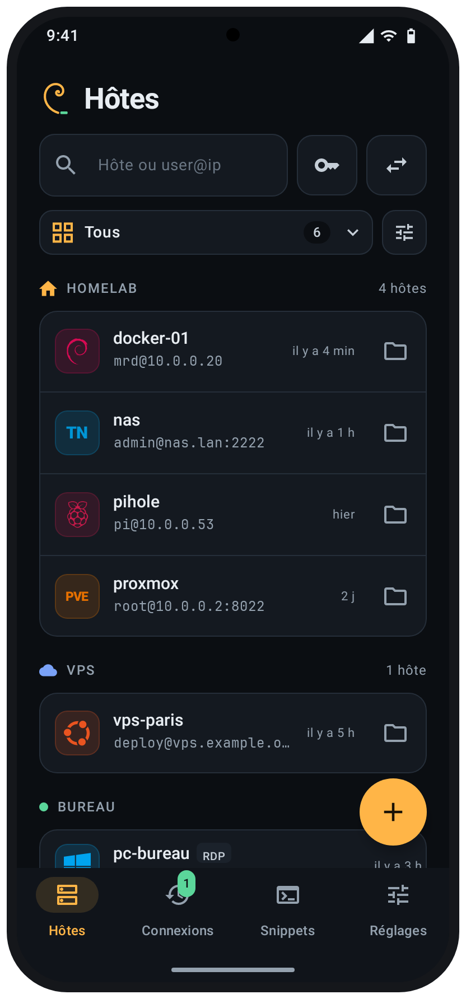
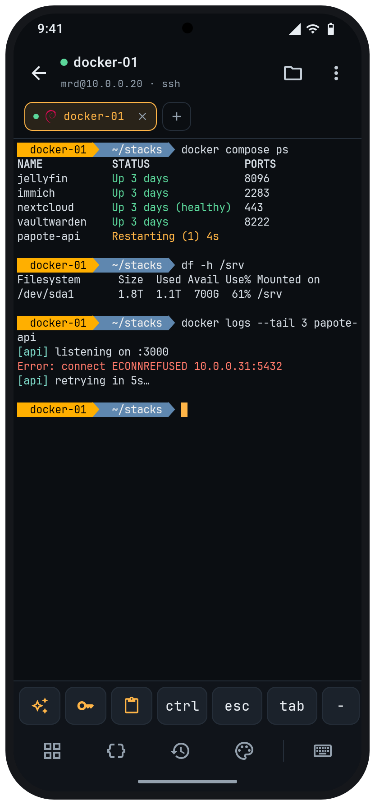
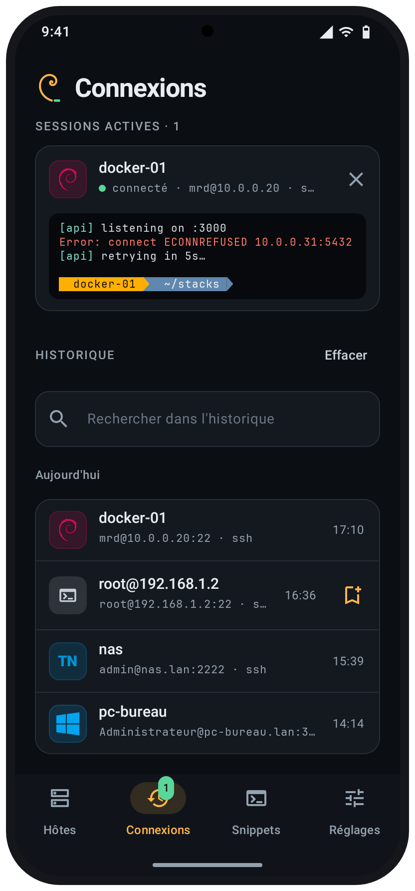
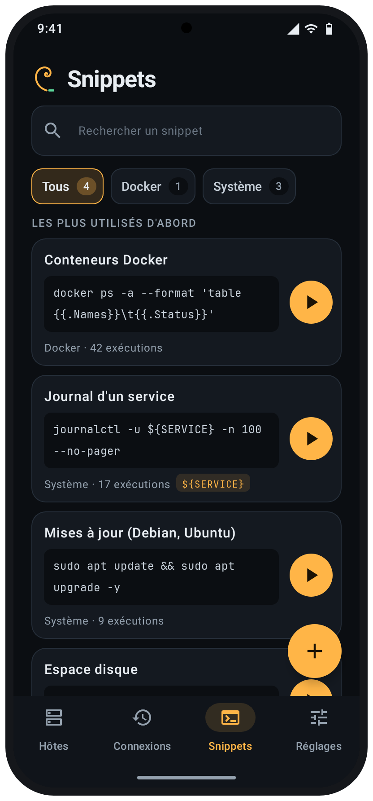
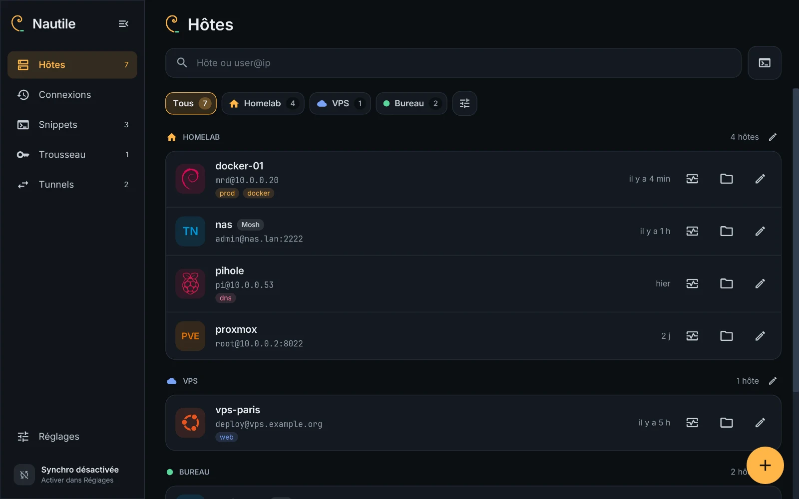
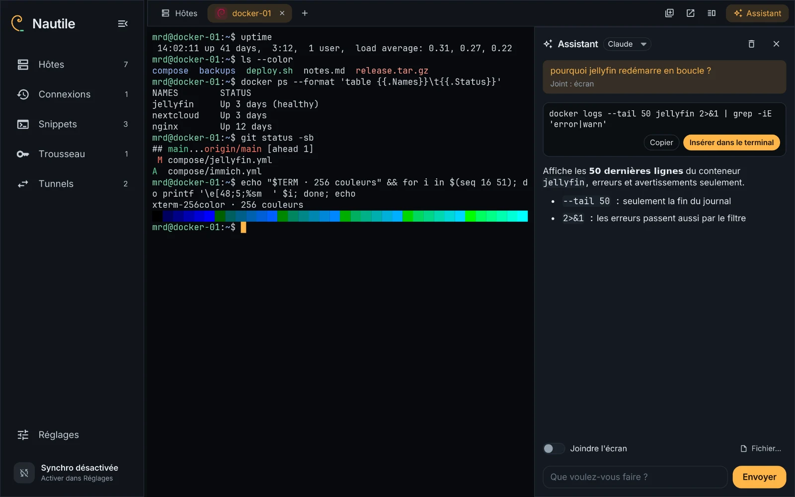
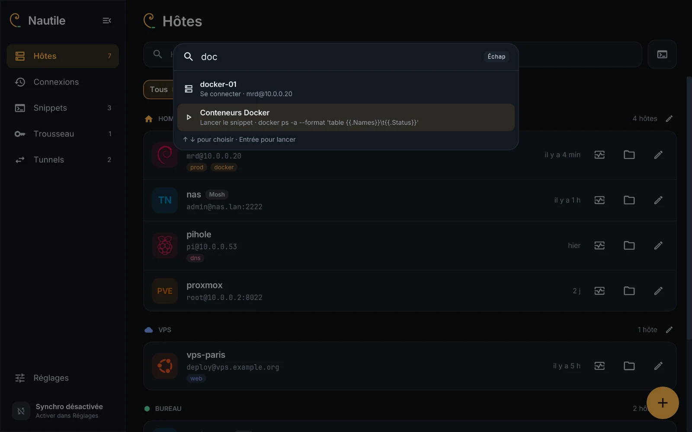

<p align="center">
  
</p>

<h1 align="center">
  <picture>
    <source media="(prefers-color-scheme: light)" srcset="docs/wordmark-light.svg">
    
  </picture>
</h1>

<p align="center">
  <b>Tes serveurs, dans ta poche.</b><br>
  Un client SSH, Mosh et bureau à distance libre pour Android, Windows, Linux et macOS.<br>
  Pas de cloud, pas de compte : tes hôtes, clés et mots de passe restent chiffrés sur tes appareils.
</p>

<p align="center">
  <a href="https://github.com/MrDDream/Nautile/releases/latest"></a>
  <a href="https://github.com/MrDDream/Nautile/releases"></a>
  <a href="https://github.com/MrDDream/Nautile/actions/workflows/ci.yml"></a>
  <a href="LICENSE"></a>
  <br>
  
  
  
  
  
</p>

<p align="center">
  <a href="https://mrddream.github.io/Nautile/"><b>Site web</b></a> ·
  <a href="https://github.com/MrDDream/Nautile/releases/latest"><b>Télécharger</b></a> ·
  <a href="https://apps.obtainium.imranr.dev/redirect?r=obtainium://add/https://github.com/MrDDream/Nautile">Installer avec Obtainium</a> ·
  <a href="README.md">English version</a>
</p>

<p align="center">
  
  
  
  
</p>

<p align="center">
  <a href="#-pourquoi-nautile-">Pourquoi</a> ·
  <a href="#-ce-quil-fait">Fonctionnalités</a> ·
  <a href="#-sur-ton-ordinateur">Ordinateur</a> ·
  <a href="#-installer">Installer</a> ·
  <a href="#-vie-privée-et-sécurité">Vie privée</a> ·
  <a href="#%EF%B8%8F-compiler-depuis-les-sources">Compiler</a>
</p>

---

## 🐚 Pourquoi Nautile ?

Termius est très bien, jusqu'au moment où tes hôtes, tes clés et tes mots de passe doivent vivre dans le cloud de quelqu'un d'autre. Nautile fait ce qu'on attend d'un téléphone (un vrai terminal, des fichiers, des tunnels, un bureau Windows quand il le faut) et garde tout **chiffré sur l'appareil**. La sauvegarde et la synchro vont où *tu* le décides : Google Drive, OneDrive, ton propre Nextcloud, un stockage S3, un dossier Syncthing, ou directement entre tes appareils sur le Wi-Fi, chiffrées avant de partir.

- **Libre et open source** (GPL-3.0) : pas de compte, pas de pub, pas de traqueur.
- **Une app sur tous tes appareils** : les mêmes hôtes, clés et snippets sur ton téléphone, ta tablette et ton ordinateur.
- **Pensée pour le tactile** sur le téléphone, **pour le clavier** sur l'ordinateur.

## ✨ Ce qu'il fait

| | |
| --- | --- |
| 🖥️ **Un vrai terminal** | xterm-256color (moteur de Termux), onglets et écran partagé, pincer pour zoomer, barre de touches personnalisable (Ctrl, Échap, flèches, tmux…), 10 thèmes plus l'import `.itermcolors`/Xresources/Alacritty, 5 Nerd Fonts ou ta propre `.ttf`. |
| 🔐 **SSH comme il faut** | Mot de passe, clés (Ed25519, RSA, ECDSA ; import OpenSSH, PEM et PuTTY) ou identités, transfert d'agent, rebonds ProxyJump, proxys SOCKS5/HTTP, port knocking, épinglage des clés d'hôte (TOFU) et touche « mot de passe sudo ». |
| 📶 **Mosh, Telnet, série, local** | Mosh en Kotlin pur (sans binaire), Telnet pour le vieux matériel, consoles série USB-OTG et le shell du téléphone. |
| 🪟 **Bureau à distance (RDP, VNC)** | FreeRDP 3 intégré : NLA/TLS, H.264 matériel, son, presse-papier, bureau redimensionné à l'écran, tactile direct ou pavé tactile, Ctrl+Alt+Suppr et touches F, via un tunnel SSH si besoin. VNC pour les bureaux Linux, macOS et Raspberry Pi (client intégré, ZRLE/Hextile, mot de passe VNC). |
| ⚡ **Connexion rapide** | Tape `root@192.168.1.2`, `nas:2222`, `rdp://admin@pc` ou `vnc://pi.lan` dans la recherche et connecte-toi sans rien enregistrer. La connexion arrive dans l'historique, prête à être enregistrée. |
| 📁 **SFTP** | Navigation, envoi et téléchargement en arrière-plan, édition de fichiers distants, permissions, copie d'hôte à hôte. Un appui long sélectionne plusieurs fichiers, à télécharger, supprimer, copier ou modifier d'un coup. |
| 🔀 **Tunnels** | Redirections locales (`-L`), distantes (`-R`) et SOCKS dynamiques (`-D`), lancées avec la session si tu veux. |
| 📌 **Snippets** | Commandes enregistrées avec `${VARIABLES}` et catégories, un éditeur avec insertions rapides (`\|`, `&&`, `sudo`…), lancées sur une ou plusieurs sessions à la fois, ou sur des hôtes ouverts pour l'occasion. |
| 🔄 **Synchro et sauvegarde** | Entre téléphones, tablettes et ordinateurs. Fichier chiffré de bout en bout (Argon2id + AES-256-GCM) sur Google Drive, OneDrive, Nextcloud/WebDAV, un stockage S3 (Backblaze B2, Cloudflare R2, MinIO…) ou un dossier synchronisé par Syncthing ; ou directement entre tes appareils sur le Wi-Fi, associés par un code à 6 chiffres (SPAKE2). Autant d'emplacements de sauvegarde que tu veux, chacun avec sa planification (de toutes les 6 h à chaque mois, à l'heure et sur le réseau choisis), les 5 dernières gardées et restaurables. La synchro fusionne élément par élément : la modification la plus récente gagne, suppressions comprises ; elle peut attendre ton VPN (WireGuard, Tailscale…) si ton serveur est privé. |
| 🛡️ **Privé par conception** | Base SQLCipher dont la clé reste dans l'Android Keystore, verrouillage par biométrie, code PIN ou mot de passe avec délai, masquage dans les apps récentes. Aucune statistique, aucun compte. |
| 🤖 **Assistant IA (optionnel)** | Ta propre clé pour Claude, OpenAI, Gemini, Grok, Mistral, DeepSeek ou un modèle local (Ollama, LM Studio). Choix du fournisseur et de tes prompts système dans le terminal, saisie ou dictée, écran ou fichiers joints (du téléphone ou du serveur), suite de la conversation et export en Markdown. Rien n'est exécuté sans ton accord. |
| ✨ **Et aussi** | Moniteur serveur (CPU, mémoire, disques, processus), aperçu en direct des sessions, groupes avec icônes et couleurs, widget et raccourcis d'écran d'accueil, journaux de session, mises à jour vérifiées et installées depuis l'app, rapports de plantage anonymisés à publier sur GitHub, français et anglais. |

## 💻 Sur ton ordinateur

<p align="center">
  
</p>
<p align="center">
  
  
</p>

Une app native pour Windows, Linux et macOS, écrite en Rust (environ 35 Mo de RAM). Elle reprend l'interface, les réglages et les thèmes du téléphone, lit ses sauvegardes et reste synchronisée avec lui, par un fichier partagé ou directement sur le Wi-Fi. Et elle ajoute ce qui sert sur un ordinateur :

- **Ctrl+K** pour chercher hôtes, snippets, réglages et actions ; Ctrl+N, Ctrl+1…9, clic droit sur un hôte, glisser-déposer vers les groupes et les onglets ;
- une icône dans la **zone de notification** : fermer la fenêtre garde sessions, tunnels et synchro actifs ; lancement avec ta session si tu veux ;
- l'**écran scindé** (côte à côte ou l'un au-dessus de l'autre) et des onglets **détachés** dans leur propre fenêtre ;
- un **moniteur de serveur** à côté des hôtes, avec la **liste des processus**, un **éditeur de fichiers SFTP** (Ctrl+S pour enregistrer), l'**import** de `~/.ssh/config` et de CSV ;
- une synchro **thème par thème** (hôtes et trousseau, tunnels, snippets, serveurs connus), et l'**accélération graphique** en option ;
- une synchro qui **attend ton VPN**, et des **mises à jour** vérifiées par leur somme de contrôle et installées en un clic.

## 📲 Installer

### Android

1. Télécharge l'APK depuis la [dernière version](https://github.com/MrDDream/Nautile/releases/latest) :
   - `Nautile-vX.Y.Z-arm64-v8a.apk` pour presque tous les téléphones récents,
   - `Nautile-vX.Y.Z-armeabi-v7a.apk` pour les anciens téléphones 32 bits,
   - `Nautile-vX.Y.Z.apk` (universel) en cas de doute.
2. Ouvre-le sur ton téléphone et autorise l'installation.
3. Ou laisse [Obtainium](https://apps.obtainium.imranr.dev/redirect?r=obtainium://add/https://github.com/MrDDream/Nautile) l'installer et le tenir à jour.

Chaque version est signée avec la même clé. Vérifie-la avec [AppVerifier](https://github.com/soupslurpr/AppVerifier) ou `apksigner verify --print-certs` :

```
com.nautile
09:88:CF:FC:59:0E:A1:60:F9:75:DF:D5:04:0B:3F:41:91:38:1A:23:30:E6:63:2A:6E:B7:CF:40:B9:A3:D7:2D
```

### Windows, Linux, macOS

Chaque [version](https://github.com/MrDDream/Nautile/releases/latest) contient aussi l'app pour ordinateur :

| Système | Fichier | Remarques |
| --- | --- | --- |
| Windows | `Nautile-X.Y.Z-setup.exe` | Installeur, sans droits administrateur. |
| Windows | `Nautile-X.Y.Z-portable.zip` | Tout (données chiffrées comprises) reste dans le dossier, par exemple sur une clé USB. Sa clé est chiffrée par un mot de passe maître demandé à chaque démarrage : mot de passe perdu, données perdues. |
| Debian, Ubuntu | `nautile_X.Y.Z-1_amd64.deb` | |
| Fedora, openSUSE | `nautile-X.Y.Z-1.x86_64.rpm` | |
| Autres Linux | `nautile-X.Y.Z-linux-x86_64.tar.gz` | |
| macOS (puces Apple) | `Nautile-X.Y.Z-macos-arm64.dmg` | Pas encore notarisé : ouvre-le une fois, puis Réglages Système › Confidentialité et sécurité › « Ouvrir quand même » (avant macOS 15 : clic droit › Ouvrir). |

Les fichiers Windows ne sont pas encore signés : SmartScreen affiche « Windows a protégé votre ordinateur » › *Informations complémentaires* › *Exécuter quand même*. Les sommes de contrôle sont dans `SHA256SUMS-desktop.txt`.

## 🔒 Vie privée et sécurité

Nautile n'a pas de serveur et ne collecte rien. Tes hôtes, clés et mots de passe restent dans une base chiffrée sur ton appareil. Aucune donnée ne part sans ton accord ; la vérification des mises à jour, si tu l'acceptes au premier lancement, contacte GitHub une fois par jour. Sinon, les données ne sortent que si tu le demandes :

- une connexion à tes propres serveurs ;
- un fichier de sauvegarde ou de synchro vers la destination choisie, chiffré avant ;
- une question au fournisseur d'IA que tu as configuré : seulement ta demande, l'adresse et le protocole de l'hôte, l'écran du terminal si tu le coches et les fichiers que tu joins.

Après un plantage, Nautile montre un rapport anonymisé que tu peux lire, puis publier toi-même dans un ticket GitHub.

**Sur ordinateur**, le verrou par code PIN ou mot de passe cache l'interface pendant ton absence (son empreinte et les essais ratés sont dans la base chiffrée) ; il ne chiffre rien à lui seul. Installée, la clé de la base est dans le trousseau du système de ta session ; en mode portable, seul le mot de passe maître (Argon2id, AES-256-GCM) l'ouvre. Code du verrou oublié ? Installée, lance une fois `nautile --reset-lock` (le verrou est retiré, rien d'autre) ; en mode portable, « Code oublié ? » sur l'écran de verrouillage le retire avec le mot de passe maître.

## 🛠️ Compiler depuis les sources

**Android** demande le JDK 17 et le SDK Android (plateforme 37) :

```bash
./gradlew testDebugUnitTest assembleDebug
```

Les bibliothèques FreeRDP, OpenSSL, cJSON et uriparser sont précompilées dans `core/rdp/src/main/jniLibs/`. Pour les reconstruire (NDK 29, CMake 3.31, perl, make, pkg-config) :

```bash
scripts/build-freerdp.sh
```

**L'app pour ordinateur** est dans `desktop/` (Rust 1.94+, iced, IronRDP, russh) :

```bash
cd desktop && cargo run --release -p nautile-app
```

**Les tests d'intégration** tournent contre de vrais serveurs dans Docker : `scripts/ssh-it.sh` (sshd, mosh-server, proxys), `scripts/vnc-it.sh` (x11vnc), `scripts/s3-it.sh` (RustFS). Pour l'ordinateur : `scripts/ssh-it.sh --desktop`, `scripts/vnc-it.sh --desktop`, `scripts/rdp-it.sh`, `scripts/store-it.sh`.

<details>
<summary>Organisation du projet</summary>

| Module | Contenu |
| --- | --- |
| `app` | Interface Compose |
| `core:data` | Room + SQLCipher, import, sauvegarde, synchro |
| `core:security` | Keystore, verrou |
| `core:ssh` | sshj, Mosh, Telnet (JVM pur) |
| `core:rdp` | FreeRDP via JNI |
| `core:vnc` | Client VNC (JVM pur) |
| `core:i18n` | Textes source en français et leurs traductions anglaises |
| `third_party/` | `terminal-emulator` et `terminal-view` de Termux |
| `desktop/crates/` | L'app pour ordinateur (`nautile-app`) et ses bibliothèques |
| `docs/` | Le [site web](https://mrddream.github.io/Nautile/) et les captures (`scripts/screenshots.sh`) |

</details>

## 🤝 Contribuer

Les bugs et idées sont les bienvenus dans les [issues](https://github.com/MrDDream/Nautile/issues). L'app est écrite en français et en anglais : les textes affichés passent par `tr("…")` et leur version anglaise vit dans `core/i18n/translations/*.tsv` (`scripts/gen-strings.py` régénère la table).

## 📄 Licence

Nautile est un logiciel libre sous [GNU GPL v3](LICENSE). Il s'appuie sur terminal-emulator de [Termux](https://github.com/termux/termux-app) (Apache 2.0), [sshj](https://github.com/hierynomus/sshj), [FreeRDP](https://www.freerdp.com) (Apache 2.0 / MPL 2.0), [iced](https://iced.rs), [IronRDP](https://github.com/Devolutions/IronRDP), [russh](https://github.com/Eugeny/russh), OpenSSL, BouncyCastle, SQLCipher et les [Nerd Fonts](https://www.nerdfonts.com). Voir [third_party/NOTICE.md](third_party/NOTICE.md) ; la liste complète des bibliothèques et de leurs licences est dans l'appli (Réglages › À propos › Licences tierces) et dans chaque paquet pour ordinateur (`THIRD-PARTY-LICENSES.txt`).
