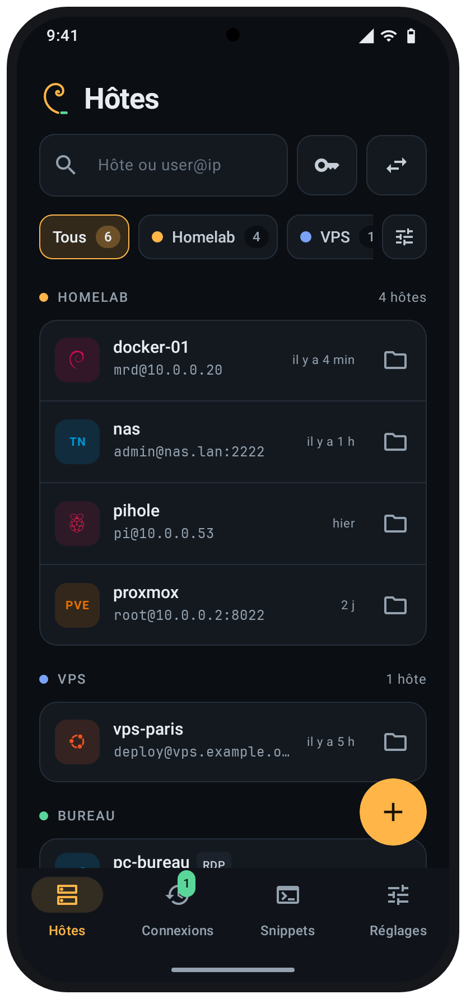
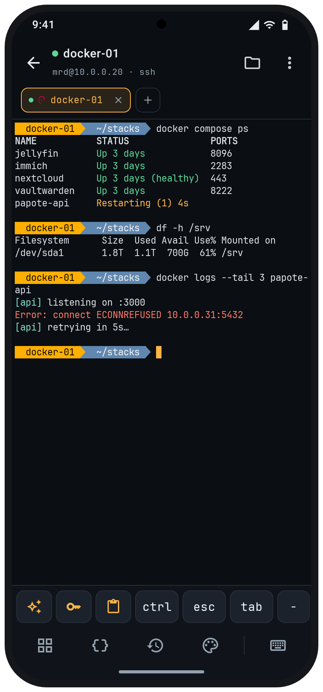
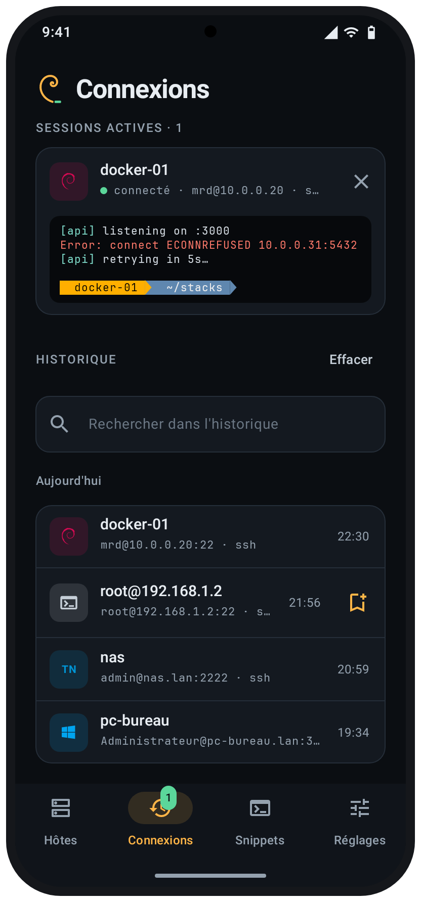
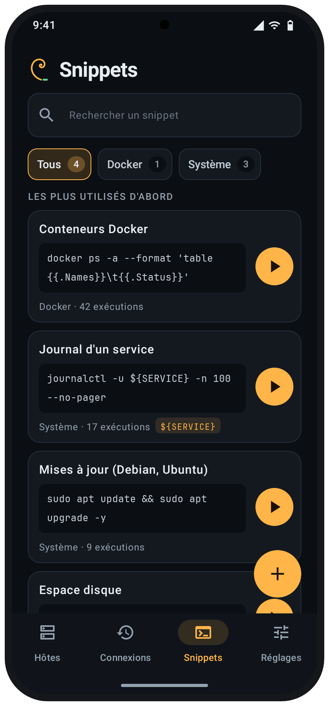

<p align="center">
  
</p>

<h1 align="center">
  <picture>
    <source media="(prefers-color-scheme: light)" srcset="docs/wordmark-light.svg">
    
  </picture>
</h1>

<p align="center">
  <b>Tes serveurs, dans ta poche.</b><br>
  Un client SSH et bureau à distance libre pour Android. Pas de cloud, pas de compte, rien ne quitte ton téléphone sans que tu le demandes.
</p>

<p align="center">
  <a href="https://github.com/MrDDream/Nautile/releases/latest"></a>
  
  
  <a href="https://mrddream.github.io/Nautile/"></a>
  <a href="LICENSE"></a>
</p>

<p align="center">
  <a href="https://mrddream.github.io/Nautile/">Site web</a> ·
  <a href="https://github.com/MrDDream/Nautile/releases/latest">Télécharger</a> ·
  <a href="https://apps.obtainium.imranr.dev/redirect?r=obtainium://add/https://github.com/MrDDream/Nautile">Installer avec Obtainium</a> ·
  <a href="README.md">English version</a>
</p>

<p align="center">
  <picture>
    <source media="(prefers-color-scheme: light)" srcset="docs/assets/shots/fr-light-hosts.png">
    
  </picture>
  <picture>
    <source media="(prefers-color-scheme: light)" srcset="docs/assets/shots/fr-light-terminal.png">
    
  </picture>
  <picture>
    <source media="(prefers-color-scheme: light)" srcset="docs/assets/shots/fr-light-connections.png">
    
  </picture>
  <picture>
    <source media="(prefers-color-scheme: light)" srcset="docs/assets/shots/fr-light-snippets.png">
    
  </picture>
</p>

---

## 🐚 Pourquoi Nautile ?

Termius est très bien, jusqu'au moment où tes hôtes, tes clés et tes mots de passe doivent vivre dans le cloud de quelqu'un d'autre. Nautile fait ce qu'on attend d'un téléphone (un vrai terminal, des fichiers, des tunnels, un bureau Windows quand il le faut) et garde tout **chiffré sur l'appareil**. La sauvegarde et la synchro vont où *tu* le décides : Google Drive, OneDrive, ton propre Nextcloud, un stockage S3, un dossier Syncthing, ou directement entre tes appareils sur le Wi-Fi, chiffrées avant de partir.

## ✨ Ce qu'il fait

| | |
| --- | --- |
| 🖥️ **Un vrai terminal** | xterm-256color (moteur de Termux), onglets et écran partagé, pincer pour zoomer, barre de touches personnalisable (Ctrl, Échap, flèches, tmux…), 10 thèmes plus l'import `.itermcolors`/Xresources/Alacritty, 5 Nerd Fonts ou ta propre `.ttf`. |
| 🔐 **SSH comme il faut** | Mot de passe, clés (Ed25519, RSA, ECDSA ; import OpenSSH, PEM et PuTTY) ou identités, transfert d'agent, rebonds ProxyJump, proxys SOCKS5/HTTP, port knocking, épinglage des clés d'hôte (TOFU) et touche « mot de passe sudo ». |
| 📶 **Mosh, Telnet, série, local** | Mosh en Kotlin pur (sans binaire), Telnet pour le vieux matériel, consoles série USB-OTG et le shell du téléphone. |
| 🪟 **Bureau à distance (RDP, VNC)** | FreeRDP 3 intégré : NLA/TLS, H.264 matériel, son, presse-papier, bureau redimensionné à l'écran, tactile direct ou pavé tactile, Ctrl+Alt+Suppr et touches F, via un tunnel SSH si besoin. VNC pour les bureaux Linux, macOS et Raspberry Pi (client intégré, ZRLE/Hextile, mot de passe VNC). |
| ⚡ **Connexion rapide** | Tape `root@192.168.1.2`, `nas:2222`, `rdp://admin@pc` ou `vnc://pi.lan` dans la recherche et connecte-toi sans rien enregistrer. La connexion arrive dans l'historique, prête à être enregistrée. |
| 📁 **SFTP** | Navigation, envoi et téléchargement en arrière-plan, édition de fichiers distants, permissions, copie d'hôte à hôte. |
| 🔀 **Tunnels** | Redirections locales (`-L`), distantes (`-R`) et SOCKS dynamiques (`-D`), lancées avec la session si tu veux. |
| 📌 **Snippets** | Commandes enregistrées avec `${VARIABLES}` et catégories, un éditeur avec insertions rapides (`|`, `&&`, `sudo`…), lancées sur une ou plusieurs sessions à la fois, ou sur des hôtes ouverts pour l'occasion. |
| 🔄 **Synchro et sauvegarde** | Fichier chiffré de bout en bout (Argon2id + AES-256-GCM) sur Google Drive, OneDrive, Nextcloud/WebDAV, un stockage S3 (Backblaze B2, Cloudflare R2, MinIO…) ou un dossier synchronisé par Syncthing ; ou directement entre tes appareils sur le Wi-Fi, associés par un code à 6 chiffres. Autant d'emplacements de sauvegarde que tu veux, chacun avec sa planification (de toutes les 6 h à chaque mois, à l'heure et sur le réseau choisis), les 5 dernières gardées et restaurables. La synchro fusionne élément par élément : la modification la plus récente gagne, suppressions comprises. |
| 🛡️ **Privé par conception** | Base SQLCipher dont la clé reste dans l'Android Keystore, verrouillage par biométrie, code PIN ou mot de passe avec délai, masquage dans les apps récentes. Aucune statistique, aucun compte. |
| 🤖 **Assistant IA (optionnel)** | Ta propre clé pour Claude, OpenAI, Gemini, Grok, Mistral, DeepSeek ou un modèle local (Ollama, LM Studio). Choix du fournisseur et de tes prompts système dans le terminal, saisie ou dictée, écran ou fichiers joints (du téléphone ou du serveur), suite de la conversation et export en Markdown. Rien n'est exécuté sans ton accord. |
| ✨ **Et aussi** | Moniteur serveur (CPU, mémoire, disques, processus), aperçu des sessions actives, widget et raccourcis d'écran d'accueil, journaux de session, rapports de plantage anonymisés à publier sur GitHub, français et anglais. |

## 📲 Installer

1. Télécharge l'APK depuis la [dernière version](https://github.com/MrDDream/Nautile/releases/latest) :
   - `Nautile-vX.Y.Z-arm64-v8a.apk` pour presque tous les téléphones récents,
   - `Nautile-vX.Y.Z-armeabi-v7a.apk` pour les anciens téléphones 32 bits,
   - `Nautile-vX.Y.Z.apk` (universel) en cas de doute.
2. Ouvre-le sur ton téléphone et autorise l'installation.
3. Ou laisse [Obtainium](https://apps.obtainium.imranr.dev/redirect?r=obtainium://add/https://github.com/MrDDream/Nautile) l'installer et le tenir à jour.

Chaque version est signée avec la même clé. Vérifie-la avec [AppVerifier](https://github.com/soupslurpr/AppVerifier) ou `apksigner verify --print-certs` :

```
com.nautile
09:88:CF:FC:59:0E:A1:60:F9:75:DF:D5:04:0B:3F:41:91:38:1A:23:30:E6:63:2A:6E:B7:CF:40:B9:A3:D7:2D
```

## 🛠️ Compiler depuis les sources

Il faut le JDK 17 et le SDK Android (plateforme 34).

```bash
./gradlew testDebugUnitTest assembleDebug
```

Les bibliothèques FreeRDP, OpenSSL, cJSON et uriparser sont précompilées dans `core/rdp/src/main/jniLibs/`. Pour les reconstruire (NDK 29, CMake 3.31, perl, make, pkg-config) :

```bash
scripts/build-freerdp.sh
```

Les tests d'intégration SSH tournent contre `sshd`, `mosh-server` et des proxys dans Docker : `scripts/ssh-it.sh` ; ceux du VNC contre x11vnc : `scripts/vnc-it.sh` ; le S3 contre RustFS : `scripts/s3-it.sh`.

Modules : `app` (interface Compose), `core:data` (Room + SQLCipher, import, sauvegarde, synchro), `core:security` (Keystore, verrou), `core:ssh` (sshj, Mosh, Telnet ; JVM pur), `core:rdp` (FreeRDP via JNI), `core:vnc` (client VNC ; JVM pur), `core:i18n`, et les `terminal-emulator` / `terminal-view` de Termux dans `third_party/`.

## 🔒 Vie privée

Nautile n'a pas de serveur et ne collecte rien. Tes hôtes, clés et mots de passe restent dans une base chiffrée sur le téléphone. Les données ne sortent que si tu le demandes : une connexion à tes propres serveurs, un fichier de sauvegarde ou de synchro vers la destination choisie (chiffré avant), ou une question au fournisseur d'IA que tu as configuré (seulement ta demande, l'adresse et le protocole de l'hôte, l'écran du terminal si tu le coches et les fichiers que tu joins). Après un plantage, Nautile montre un rapport anonymisé que tu peux publier toi-même dans un ticket GitHub.

## 🤝 Contribuer

Les bugs et idées sont les bienvenus dans les [issues](https://github.com/MrDDream/Nautile/issues). L'app est écrite en français et en anglais : les textes affichés passent par `tr("…")` et leur version anglaise vit dans `core/i18n/translations/*.tsv` (`scripts/gen-strings.py` régénère la table).

## 📄 Licence

Nautile est un logiciel libre sous [GNU GPL v3](LICENSE). Il s'appuie sur terminal-emulator de [Termux](https://github.com/termux/termux-app) (Apache 2.0), [sshj](https://github.com/hierynomus/sshj), [FreeRDP](https://www.freerdp.com) (Apache 2.0 / MPL 2.0), OpenSSL, BouncyCastle, SQLCipher et les [Nerd Fonts](https://www.nerdfonts.com). Voir [third_party/NOTICE.md](third_party/NOTICE.md).
