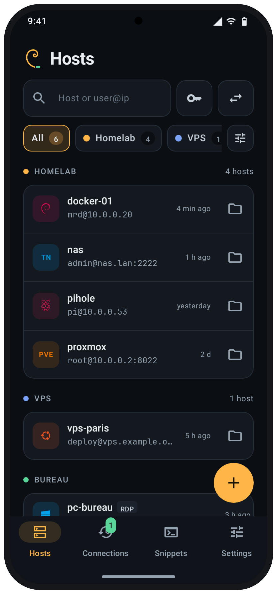
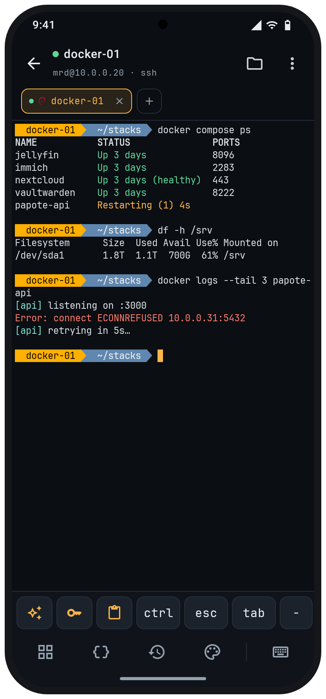
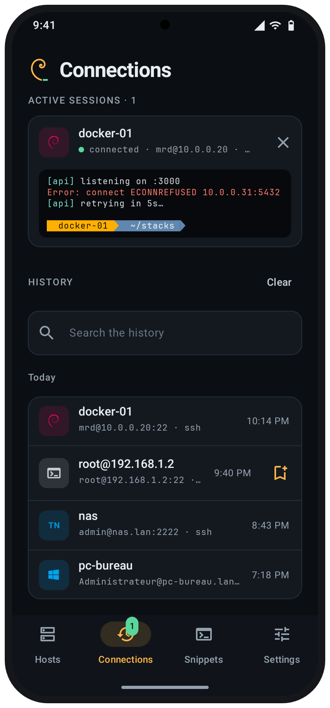
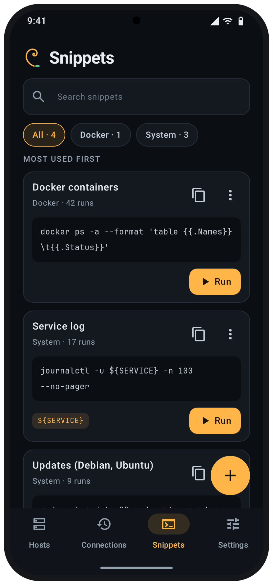

<p align="center">
  
</p>

<h1 align="center">
  <picture>
    <source media="(prefers-color-scheme: light)" srcset="docs/wordmark-light.svg">
    
  </picture>
</h1>

<p align="center">
  <b>Your servers, in your pocket.</b><br>
  A free SSH and remote-desktop client for Android. No cloud, no account, nothing leaves your phone unless you ask.
</p>

<p align="center">
  <a href="https://github.com/MrDDream/Nautile/releases/latest"></a>
  
  
  <a href="https://mrddream.github.io/Nautile/"></a>
  <a href="LICENSE"></a>
</p>

<p align="center">
  <a href="https://mrddream.github.io/Nautile/">Website</a> ·
  <a href="https://github.com/MrDDream/Nautile/releases/latest">Download</a> ·
  <a href="https://apps.obtainium.imranr.dev/redirect?r=obtainium://add/https://github.com/MrDDream/Nautile">Get it with Obtainium</a> ·
  <a href="README.fr.md">Version française</a>
</p>

<p align="center">
  <picture>
    <source media="(prefers-color-scheme: light)" srcset="docs/assets/shots/en-light-hosts.png">
    
  </picture>
  <picture>
    <source media="(prefers-color-scheme: light)" srcset="docs/assets/shots/en-light-terminal.png">
    
  </picture>
  <picture>
    <source media="(prefers-color-scheme: light)" srcset="docs/assets/shots/en-light-connections.png">
    
  </picture>
  <picture>
    <source media="(prefers-color-scheme: light)" srcset="docs/assets/shots/en-light-snippets.png">
    
  </picture>
</p>

---

## 🐚 Why Nautile?

Termius is great, until your hosts, keys and passwords have to live in someone else's cloud. Nautile does what you need from a phone (a real terminal, files, tunnels, a Windows desktop when you must) and keeps everything **encrypted on the device**. Backup and sync go where *you* choose: Google Drive, OneDrive or your own Nextcloud, encrypted before they leave.

## ✨ What it does

| | |
| --- | --- |
| 🖥️ **A real terminal** | xterm-256color (Termux engine), tabs and split screen, pinch to zoom, a customisable key bar (Ctrl, Esc, arrows, tmux…), 10 colour themes plus `.itermcolors`/Xresources/Alacritty import, 5 Nerd Fonts or your own `.ttf`. |
| 🔐 **SSH done right** | Password, keys (Ed25519, RSA, ECDSA; OpenSSH, PEM and PuTTY import) or identities, agent forwarding, ProxyJump chains, SOCKS5/HTTP proxies, port knocking, host-key pinning (TOFU) and a sudo-password key. |
| 📶 **Mosh, Telnet, serial, local** | Mosh in pure Kotlin (no binary), Telnet for old gear, USB-OTG serial consoles and the phone's own shell. |
| 🪟 **Remote desktop (RDP)** | FreeRDP 3 inside: NLA/TLS, hardware H.264, sound, clipboard, desktop resized to the screen, direct-touch or touchpad mode, Ctrl+Alt+Del and F-keys, through an SSH tunnel if needed. |
| ⚡ **Quick connection** | Type `root@192.168.1.2`, `nas:2222` or `rdp://admin@pc` in the search bar and connect without saving anything. It lands in the history, ready to be saved. |
| 📁 **SFTP** | Browse, upload and download in the background, edit remote files, change permissions, copy host to host. |
| 🔀 **Tunnels** | Local (`-L`), remote (`-R`) and dynamic SOCKS (`-D`) forwards, started with the session if you like. |
| 📌 **Snippets** | Saved commands with `${VARIABLES}` and categories, an editor with quick inserts (`|`, `&&`, `sudo`…), run on one or several sessions at once, or on hosts that open for the occasion. |
| 🔄 **Sync & backup** | End-to-end encrypted file (Argon2id + AES-256-GCM) on Google Drive, OneDrive or Nextcloud/WebDAV. Scheduled backups (every 6 h to monthly, at the time and on the network you choose), the last 5 kept and restorable. Sync merges record by record, latest change wins, deletions included. |
| 🛡️ **Private by design** | SQLCipher database with its key in the Android Keystore, biometric lock with re-lock delay, hidden from recent apps if you want. No analytics, no account. |
| 🤖 **AI assistant (optional)** | Your own key for Claude, OpenAI, Gemini, Grok, Mistral, DeepSeek or a local model (Ollama, LM Studio). Pick the provider and your own system prompts in the terminal, type or dictate, attach the screen or files (from the phone or the server), follow up in a conversation and export it as Markdown. Nothing runs without your tap. |
| ✨ **And more** | Server monitor (CPU, memory, disks, processes), active-session previews, home-screen widget and shortcuts, session logs, anonymised crash reports you can post on GitHub, English and French. |

## 📲 Install

1. Download the APK from the [latest release](https://github.com/MrDDream/Nautile/releases/latest):
   - `Nautile-vX.Y.Z-arm64-v8a.apk` for almost every recent phone,
   - `Nautile-vX.Y.Z-armeabi-v7a.apk` for older 32-bit phones,
   - `Nautile-vX.Y.Z.apk` (universal) if unsure.
2. Open it on your phone and allow the installation.
3. Or let [Obtainium](https://apps.obtainium.imranr.dev/redirect?r=obtainium://add/https://github.com/MrDDream/Nautile) install it and keep it up to date.

Every release is signed with the same key. Check it with [AppVerifier](https://github.com/soupslurpr/AppVerifier) or `apksigner verify --print-certs`:

```
com.nautile
09:88:CF:FC:59:0E:A1:60:F9:75:DF:D5:04:0B:3F:41:91:38:1A:23:30:E6:63:2A:6E:B7:CF:40:B9:A3:D7:2D
```

## 🛠️ Build from source

Requirements: JDK 17 and the Android SDK (platform 34).

```bash
./gradlew testDebugUnitTest assembleDebug
```

The FreeRDP, OpenSSL, cJSON and uriparser libraries are prebuilt in `core/rdp/src/main/jniLibs/`. To rebuild them (NDK 29, CMake 3.31, perl, make, pkg-config):

```bash
scripts/build-freerdp.sh
```

SSH integration tests run against `sshd`, `mosh-server` and proxies in Docker: `scripts/ssh-it.sh`.

Modules: `app` (Compose UI), `core:data` (Room + SQLCipher, import, backup, sync), `core:security` (Keystore, lock), `core:ssh` (sshj, Mosh, Telnet; pure JVM), `core:rdp` (FreeRDP over JNI), `core:i18n`, and the Termux `terminal-emulator` / `terminal-view` under `third_party/`.

## 🔒 Privacy

Nautile has no server and collects nothing. Your hosts, keys and passwords stay in an encrypted database on the phone. Data leaves the device only when you ask: a connection to your own servers, a backup or sync file to the destination you picked (encrypted first), or a request to the AI provider you configured (only your question, the host's address and protocol, the terminal screen if you tick it and the files you attach). After a crash, Nautile shows an anonymised report that you can post as a GitHub issue yourself.

## 🤝 Contributing

Bug reports and ideas are welcome in the [issues](https://github.com/MrDDream/Nautile/issues). The app is written in French and English: user-facing strings go through `tr("…")` and their English text lives in `core/i18n/translations/*.tsv` (`scripts/gen-strings.py` regenerates the table).

## 📄 License

Nautile is free software under the [GNU GPL v3](LICENSE). It builds on [Termux](https://github.com/termux/termux-app) terminal-emulator (Apache 2.0), [sshj](https://github.com/hierynomus/sshj), [FreeRDP](https://www.freerdp.com) (Apache 2.0 / MPL 2.0), OpenSSL, BouncyCastle, SQLCipher and [Nerd Fonts](https://www.nerdfonts.com). See [third_party/NOTICE.md](third_party/NOTICE.md).
