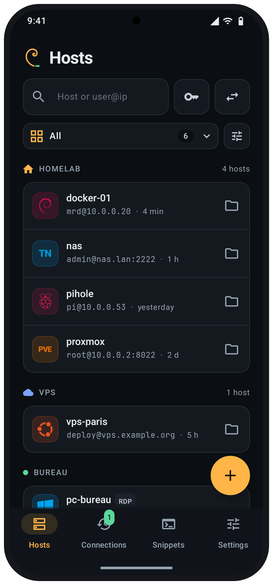
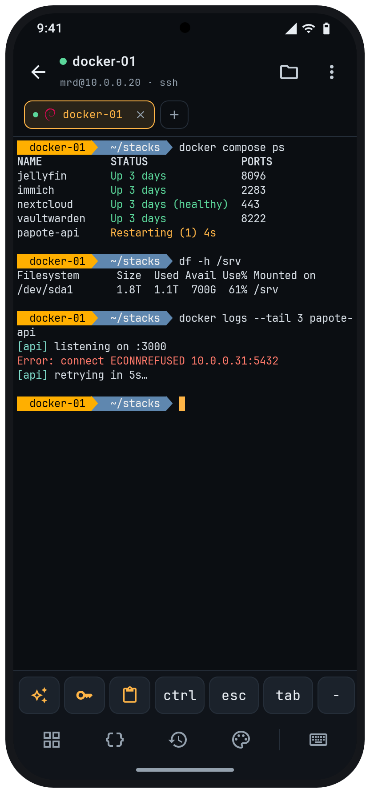
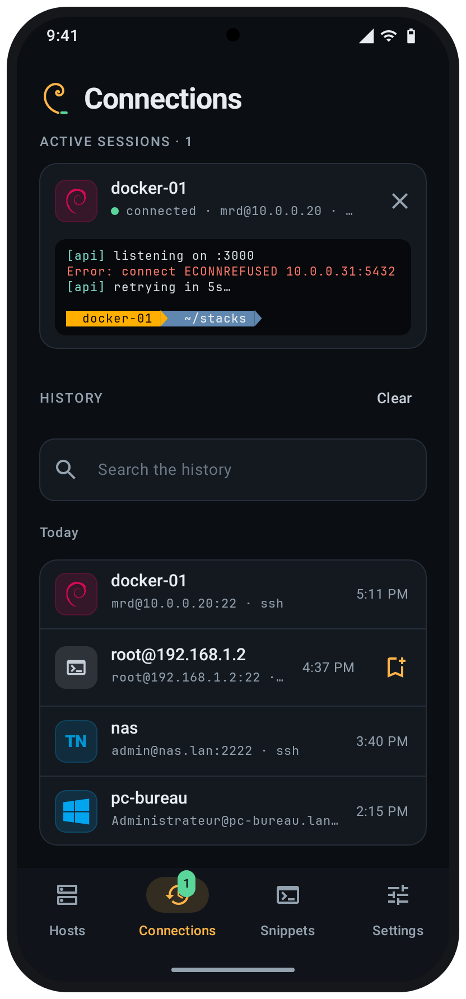
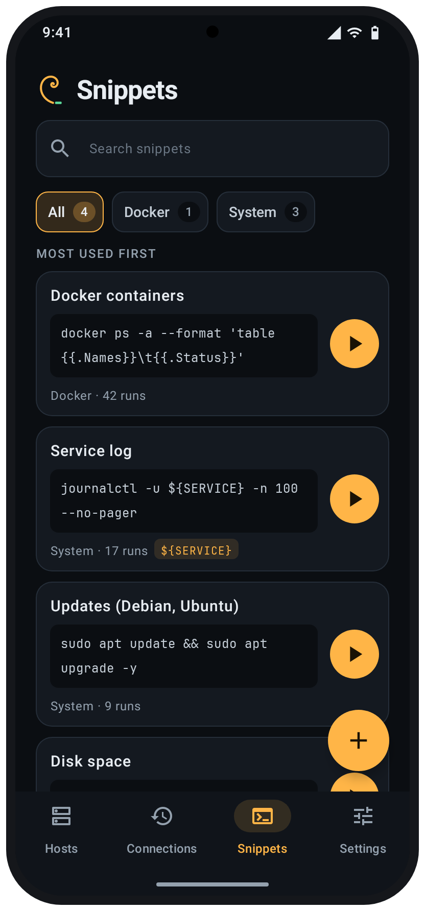
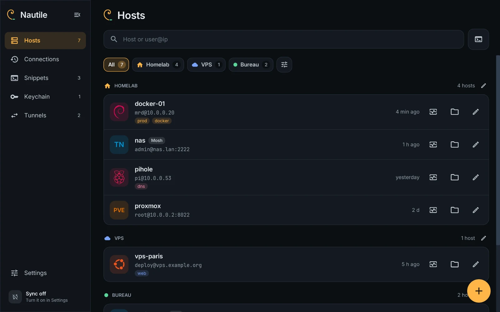
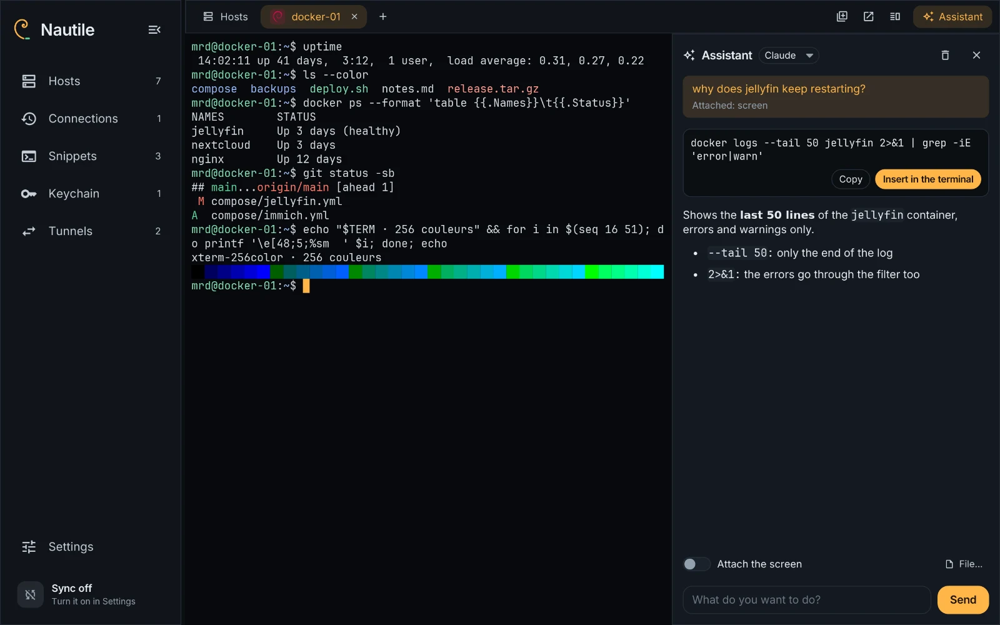
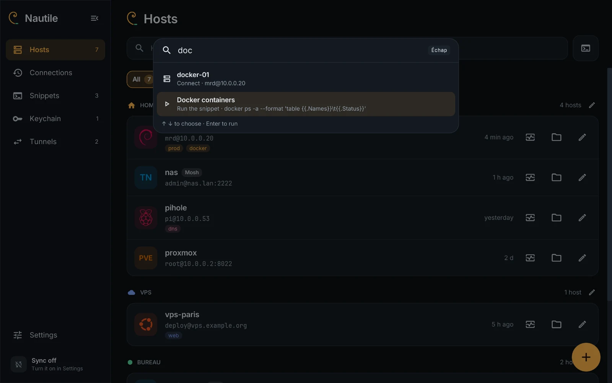

<p align="center">
  
</p>

<h1 align="center">
  <picture>
    <source media="(prefers-color-scheme: light)" srcset="docs/wordmark-light.svg">
    
  </picture>
</h1>

<p align="center">
  <b>Your servers, in your pocket.</b><br>
  A free SSH, Mosh and remote-desktop client for Android, Windows, Linux and macOS.<br>
  No cloud, no account: your hosts, keys and passwords stay encrypted on your devices.
</p>

<p align="center">
  <a href="https://github.com/MrDDream/Nautile/releases/latest"></a>
  <a href="https://github.com/MrDDream/Nautile/releases"></a>
  <a href="https://github.com/MrDDream/Nautile/actions/workflows/ci.yml"></a>
  <a href="LICENSE"></a>
  <br>
  
  
  
  
  
</p>

<p align="center">
  <a href="https://mrddream.github.io/Nautile/"><b>Website</b></a> ·
  <a href="https://github.com/MrDDream/Nautile/releases/latest"><b>Download</b></a> ·
  <a href="https://apps.obtainium.imranr.dev/redirect?r=obtainium://add/https://github.com/MrDDream/Nautile">Get it with Obtainium</a> ·
  <a href="README.fr.md">Version française</a>
</p>

<p align="center">
  
  
  
  
</p>

<p align="center">
  <a href="#-why-nautile">Why</a> ·
  <a href="#-what-it-does">Features</a> ·
  <a href="#-on-your-computer">Desktop</a> ·
  <a href="#-install">Install</a> ·
  <a href="#-privacy-and-security">Privacy</a> ·
  <a href="#%EF%B8%8F-build-from-source">Build</a>
</p>

---

## 🐚 Why Nautile?

Termius is great, until your hosts, keys and passwords have to live in someone else's cloud. Nautile does what you need from a phone (a real terminal, files, tunnels, a Windows desktop when you must) and keeps everything **encrypted on the device**. Backup and sync go where *you* choose: Google Drive, OneDrive, your own Nextcloud, S3 storage, a Syncthing folder, or straight between your devices over Wi-Fi, encrypted before they leave.

- **Free and open source** (GPL-3.0), no account, no ads, no tracker.
- **One app on every device**: the same hosts, keys and snippets on your phone, tablet and computer.
- **Made for touch** on the phone, **made for the keyboard** on the computer.

## ✨ What it does

| | |
| --- | --- |
| 🖥️ **A real terminal** | xterm-256color (Termux engine), tabs and split screen, pinch to zoom, a customisable key bar (Ctrl, Esc, arrows, tmux…), 10 colour themes plus `.itermcolors`/Xresources/Alacritty import, 5 Nerd Fonts or your own `.ttf`. |
| 🔐 **SSH done right** | Password, keys (Ed25519, RSA, ECDSA; OpenSSH, PEM and PuTTY import) or identities, agent forwarding, ProxyJump chains, SOCKS5/HTTP proxies, port knocking, host-key pinning (TOFU) and a sudo-password key. |
| 📶 **Mosh, Telnet, serial, local** | Mosh in pure Kotlin (no binary), Telnet for old gear, USB-OTG serial consoles and the phone's own shell. |
| 🪟 **Remote desktop (RDP, VNC)** | FreeRDP 3 inside: NLA/TLS, hardware H.264, sound, clipboard, desktop resized to the screen, direct-touch or touchpad mode, Ctrl+Alt+Del and F-keys, through an SSH tunnel if needed. VNC for Linux, macOS and Raspberry Pi desktops (built-in client, ZRLE/Hextile, VNC password). |
| ⚡ **Quick connection** | Type `root@192.168.1.2`, `nas:2222`, `rdp://admin@pc` or `vnc://pi.lan` in the search bar and connect without saving anything. It lands in the history, ready to be saved. |
| 📁 **SFTP** | Browse, upload and download in the background, edit remote files, change permissions, copy host to host. Long-press to select several files, then download, delete, copy or change them all at once. |
| 🔀 **Tunnels** | Local (`-L`), remote (`-R`) and dynamic SOCKS (`-D`) forwards, started with the session if you like. |
| 📌 **Snippets** | Saved commands with `${VARIABLES}` and categories, an editor with quick inserts (`\|`, `&&`, `sudo`…), run on one or several sessions at once, or on hosts that open for the occasion. |
| 🔄 **Sync & backup** | Between phones, tablets and computers. End-to-end encrypted file (Argon2id + AES-256-GCM) on Google Drive, OneDrive, Nextcloud/WebDAV, S3 storage (Backblaze B2, Cloudflare R2, MinIO…) or a folder synced by Syncthing; or straight between your devices over Wi-Fi, paired with a 6-digit code (SPAKE2). As many backup locations as you like, each with its own schedule (every 6 h to monthly, at the time and on the network you choose), the last 5 kept and restorable. Sync merges record by record, latest change wins, deletions included; it can wait for your VPN (WireGuard, Tailscale…) when your server is private. |
| 🛡️ **Private by design** | SQLCipher database with its key in the Android Keystore, app lock by biometrics, PIN or password with re-lock delay, hidden from recent apps if you want. No analytics, no account. |
| 🤖 **AI assistant (optional)** | Your own key for Claude, OpenAI, Gemini, Grok, Mistral, DeepSeek or a local model (Ollama, LM Studio). Pick the provider and your own system prompts in the terminal, type or dictate, attach the screen or files (from the phone or the server), follow up in a conversation and export it as Markdown. Nothing runs without your tap. |
| ✨ **And more** | Server monitor (CPU, memory, disks, processes), live session previews, groups with icons and colours, home-screen widget and shortcuts, session logs, updates checked and installed from the app, anonymised crash reports you can post on GitHub, English and French. |

## 💻 On your computer

<p align="center">
  
</p>
<p align="center">
  
  
</p>

A native app for Windows, Linux and macOS, written in Rust (about 35 MB of RAM). It has the phone's interface, settings and themes, reads the phone's backups and stays in sync with it, through a shared file or straight over Wi-Fi. On top of that, what a computer needs:

- **Ctrl+K** to search hosts, snippets, settings and actions; Ctrl+N, Ctrl+1…9, right click on a host, drag and drop onto groups and tabs;
- an icon in the **notification area**: closing the window keeps sessions, tunnels and sync running; starts with your session if you want;
- **split screen** (side by side or stacked) and tabs **detached** into windows of their own;
- a **server monitor** beside your hosts, with the **process list**, an **SFTP file editor** (Ctrl+S to save), `~/.ssh/config` and CSV **import**;
- sync **theme by theme** (hosts and keys, tunnels, snippets, known servers), and optional **graphics acceleration**;
- sync that **waits for your VPN**, and **updates** checked against their checksum and installed in one click.

## 📲 Install

### Android

1. Download the APK from the [latest release](https://github.com/MrDDream/Nautile/releases/latest):
   - `Nautile-vX.Y.Z-arm64-v8a.apk` for almost every recent phone,
   - `Nautile-vX.Y.Z-armeabi-v7a.apk` for older 32-bit phones,
   - `Nautile-vX.Y.Z.apk` (universal) if unsure.
2. Open it on your phone and allow the installation.
3. Or let [Obtainium](https://apps.obtainium.imranr.dev/redirect?r=obtainium://add/https://github.com/MrDDream/Nautile) install it and keep it up to date.

Every release is signed with the same key. Check it with [AppVerifier](https://github.com/soupslurpr/AppVerifier) or `apksigner verify --print-certs`:

```
com.nautile
09:88:CF:FC:59:0E:A1:60:F9:75:DF:D5:04:0B:3F:41:91:38:1A:23:30:E6:63:2A:6E:B7:CF:40:B9:A3:D7:2D
```

### Windows, Linux, macOS

Each [release](https://github.com/MrDDream/Nautile/releases/latest) carries the desktop app too:

| System | File | Notes |
| --- | --- | --- |
| Windows | `Nautile-X.Y.Z-setup.exe` | Installer, no administrator rights needed. |
| Windows | `Nautile-X.Y.Z-portable.zip` | Everything (encrypted data included) stays in the folder, e.g. on a USB stick. Its key is encrypted with a master password asked at every start: lost password, lost data. |
| Debian, Ubuntu | `nautile_X.Y.Z-1_amd64.deb` | |
| Fedora, openSUSE | `nautile-X.Y.Z-1.x86_64.rpm` | |
| Other Linux | `nautile-X.Y.Z-linux-x86_64.tar.gz` | |
| macOS (Apple silicon) | `Nautile-X.Y.Z-macos-arm64.dmg` | Not notarised yet: open it once, then System Settings › Privacy & Security › *Open Anyway* (before macOS 15: right click › Open). |

The Windows files are not signed yet: SmartScreen shows « Windows protected your PC » › *More info* › *Run anyway*. Checksums are in `SHA256SUMS-desktop.txt`.

## 🔒 Privacy and security

Nautile has no server and collects nothing. Your hosts, keys and passwords stay in an encrypted database on your device. No data leaves without your consent; the update check, if you accept it at first launch, contacts GitHub once a day. Otherwise data leaves the device only when you ask:

- a connection to your own servers;
- a backup or sync file to the destination you picked, encrypted first;
- a request to the AI provider you configured: only your question, the host's address and protocol, the terminal screen if you tick it and the files you attach.

After a crash, Nautile shows an anonymised report that you can read, then post as a GitHub issue yourself.

**On a computer**, the app's PIN or password lock hides the interface while you are away (its hash and wrong tries are kept in the encrypted database); it does not encrypt anything by itself. Installed, the database key is in your session's system keyring; in portable mode only the master password (Argon2id, AES-256-GCM) opens it. Forgot the lock code? Installed, start `nautile --reset-lock` once (the lock is removed, nothing else); in portable mode, « Forgot the code? » on the lock screen removes it with the master password.

## 🛠️ Build from source

**Android** needs JDK 17 and the Android SDK (platform 37):

```bash
./gradlew testDebugUnitTest assembleDebug
```

The FreeRDP, OpenSSL, cJSON and uriparser libraries are prebuilt in `core/rdp/src/main/jniLibs/`. To rebuild them (NDK 29, CMake 3.31, perl, make, pkg-config):

```bash
scripts/build-freerdp.sh
```

**Desktop** lives in `desktop/` (Rust 1.94+, iced, IronRDP, russh):

```bash
cd desktop && cargo run --release -p nautile-app
```

**Integration tests** run against real servers in Docker: `scripts/ssh-it.sh` (sshd, mosh-server, proxies), `scripts/vnc-it.sh` (x11vnc), `scripts/s3-it.sh` (RustFS). For the desktop: `scripts/ssh-it.sh --desktop`, `scripts/vnc-it.sh --desktop`, `scripts/rdp-it.sh`, `scripts/store-it.sh`.

<details>
<summary>Project layout</summary>

| Module | What it holds |
| --- | --- |
| `app` | Compose UI |
| `core:data` | Room + SQLCipher, import, backup, sync |
| `core:security` | Keystore, lock |
| `core:ssh` | sshj, Mosh, Telnet (pure JVM) |
| `core:rdp` | FreeRDP over JNI |
| `core:vnc` | VNC client (pure JVM) |
| `core:i18n` | French source strings and their English translations |
| `third_party/` | Termux `terminal-emulator` and `terminal-view` |
| `desktop/crates/` | The desktop app (`nautile-app`) and its libraries |
| `docs/` | The [website](https://mrddream.github.io/Nautile/) and screenshots (`scripts/screenshots.sh`) |

</details>

## 🤝 Contributing

Bug reports and ideas are welcome in the [issues](https://github.com/MrDDream/Nautile/issues). The app is written in French and English: user-facing strings go through `tr("…")` and their English text lives in `core/i18n/translations/*.tsv` (`scripts/gen-strings.py` regenerates the table).

## 📄 License

Nautile is free software under the [GNU GPL v3](LICENSE). It builds on [Termux](https://github.com/termux/termux-app) terminal-emulator (Apache 2.0), [sshj](https://github.com/hierynomus/sshj), [FreeRDP](https://www.freerdp.com) (Apache 2.0 / MPL 2.0), [iced](https://iced.rs), [IronRDP](https://github.com/Devolutions/IronRDP), [russh](https://github.com/Eugeny/russh), OpenSSL, BouncyCastle, SQLCipher and [Nerd Fonts](https://www.nerdfonts.com). See [third_party/NOTICE.md](third_party/NOTICE.md); the full list of libraries and their licences is in the app (Settings › About › Third-party licences) and in every desktop package (`THIRD-PARTY-LICENSES.txt`).
